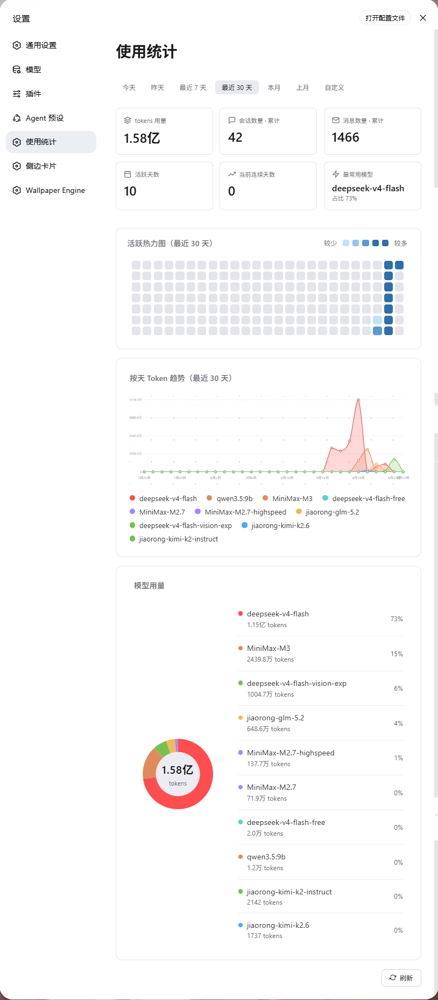

# 仿zcode的使用统计（zcode-usage-stats）

在 DeepSeek Harness（DSH）设置页提供的 Token 用量统计插件：扫描全历史会话，聚合每天 / 每小时 / 每个模型的 Token 用量，并以「按天 / 按小时趋势图」「模型用量仪表盘」「活跃热力图」展示。

## 界面预览




## 特性

- **多种时间范围**：今天、昨天、最近 7 天、最近 30 天、本月、上月、**全部（累积）**、自定义区间（自研日期选择器，年 / 月 / 日均可点选，起止自动校验防倒序）。
- **「全部」一键累积**：不枚举日期、不手动选区间，直接取宿主全历史扫描结果；标题下注明实际起止区间与有活动天数，累积 tokens / 活跃天数 / 模型占比与全量口径完全一致。
- **长区间自动降采样**：区间过长时趋势图自动按「周 / 月 / 季度」聚合（按日历边界分桶，绘图点数控制在 60 以内），标题与说明行标注聚合粒度，悬停可见该桶含几天。
- **单日窗口自动切换按小时**：选择今天 / 昨天 / 单日自定义时，趋势图横轴从「天」自动变为「小时」。
- **多模型面积趋势图**：Catmull-Rom 平滑曲线 + 参考线 + 数据点吸附提示，图例可显隐单系列；曲线裁剪保证不越坐标轴。
- **模型用量仪表盘**：环形占比 + 图例，窗口口径统一。
- **活跃热力图**：GitHub 风格，按窗口日折叠列，hover 放大 + tooltip。
- **深浅主题跟随**：颜色与 DSH 主题（`<body data-ds-dark-theme>`）联动切换，不写死。
- **增量扫描（v0.3.0 重写）**：每个会话单独缓存聚合结果并用 `sizeBytes:mtimeMs` 指纹判定是否变化，**旧会话不再被重复读取**；刷新只重读有变化的会话。实测同一台机器、352 个会话 / 297 MB 语料：冷启动 12.6 s，暖刷新 **204 ms 且只读 2 个活跃会话**，连续第二次刷新 **0 次读取**。
- **部分扫描也安全**：扫描按会话合并进上一份完整结果，中途超时不会把残缺数据当成权威（旧版本会把只有 48% 覆盖率的结果标成 `ok: true` 并持久化）。`scanState.complete === false` 时前端会显示进度，并提供「重建全部」入口。
- **扫描不再卡界面**：并发从 8 降到 2（实测吞吐 16.9 → 26.6 MB/s），并在会话之间主动 `setImmediate` 让出事件循环。

## 安装

先确保已安装 `@deepseek-ai/dsh`（以及 `pnpm`，DSH 插件命令依赖）：

```bash
dsh plugin --profile web add zcode-usage-stats
```

或从 GitHub 源码安装：

```bash
dsh plugin --profile web add github:<你的用户名>/zcode-usage-stats
```

安装后重启 DSH 进程，打开 **设置 → 使用统计** 即可看到统计页面。

## 使用

- 顶部切换时间范围（含「全部」累积视图），或点击「自定义」弹出日期选择卡片选择起止日期。
- 「全部」下数据点过多时趋势图自动按周 / 月 / 季度聚合，数值总量不变；热力图仍按天显示全历史。
- 趋势图可悬停查看参考线联动数据，点击图例项显隐对应模型。
- 「刷新」重新校验会话指纹，只重读有变化的会话（通常几十到几百毫秒）。
- 若扫描未完成，会出现「重建全部」按钮，忽略缓存把全部会话重新解码一遍（排障用，耗时约 13 s）。

### HTTP 接口

`GET /api/usage-stats`

| 参数 | 语义 |
| --- | --- |
| （无） | 直接返回缓存；过期则后台异步增量刷新（SWR） |
| `?refresh=1` | 校验指纹，只重读有变化的会话 |
| `?rebuild=1` | 忽略指纹，全部重新解码（排障用） |

响应在原有字段之外新增：

- `scanState`：`{ total, done, reused, pending, failed, complete, lastCompleteAt }`——诚实反映本轮扫描的完成度。
- `warnings`：本轮扫描的失败 / 降级提示（最多 6 条）。

## 兼容性

- 针对 DSH 开发者预览版开发，锁定 `@deepseek-ai/dsh` 的 `>=0.1.0-rc.5`。
- 依赖 DSH 宿主提供的 `sessionPersistence`、`webServer` 服务，以及客户端运行时的 `@deepseek-ai/dsh-client-runtime`、`@deepseek-ai/dsh-client-ui-slots`。

## 数据口径

- token 用量：以 `assistant/message` 事件携带的全量 `usage` 为准；同一 `turn:step` 的重复上报只计一次。
- turns：以 `step/end` 事件按新 turn 计数。
- 模型归属：优先取 `message.source.model`（实测 100% 存在），因此不再解析体积巨大的 `request/header`（占明文 5.8%）。
- fork（seeded）会话：从 `handle.inheritedEventCount` 起读，**不重复计算**从父会话继承的前缀。
- 未知模型归并为 `other`。
- 「全部」区间的 tokens / 活跃天数 / 模型占比与宿主 `GET /api/usage-stats` 的全量口径严格相等；趋势图仅在绘图点数上做周 / 月 / 季度聚合，不改变任何总量。

## 性能设计

扫描不再每轮重读全部历史，而是按会话增量聚合：

1. `sessionPersistence.list()` 拿到全部快照（含 `sizeBytes` / `revision` / `location`）。
2. 对每个会话算指纹 `sizeBytes:mtimeMs`；指纹未变则直接复用上次聚合，**零磁盘读取**。
3. 只有指纹变化的会话才 `open(id,'read')` → `read(inheritedEventCount)` → 折叠成该会话的紧凑聚合（实测 352 个会话合计约 78 KB）。
4. 所有会话聚合再折叠成全局结果，前端拿到仍是原来的 `days / totals / grandTotal` 结构。

宿主 `revision` 的契约是「仅在同一 service 实例内可比」，不能跨进程重启复用，所以只用它做进程内快速路径；跨重启靠 `sizeBytes:mtimeMs` 指纹。

部分扫描（超出时间预算）时，已扫的会话是新值、未扫的保留旧值，结果**只增不减**，不会再出现「48% 覆盖率却标记 ok」的情况。

## 测试

零依赖，无需安装任何包：

```bash
node test/all-range.test.mjs   # 客户端：63 项断言
node test/scan.test.mjs        # 宿主扫描：35 项断言
```

`test/all-range.test.mjs` 覆盖「全部」tab 与数据口径、长区间自动降采样（周 / 月 / 季度）、原有 6 个预设范围与自定义区间的回归、单日按小时、空数据与倒序区间等边界。

`test/scan.test.mjs` 覆盖扫描核心：冷启动 / 指纹未变时零读取 / 只重读变化的会话 / 读取失败不降级 / 部分扫描诚实上报且可补齐 / fork 不重复计数 / 模型取自 `message.source` / 同 step 去重 / `rebuild=1` / 会话删除 / 旧 schema 缓存迁移。全部使用合成 fixture，不读取真实会话语料。

## 许可

MIT
